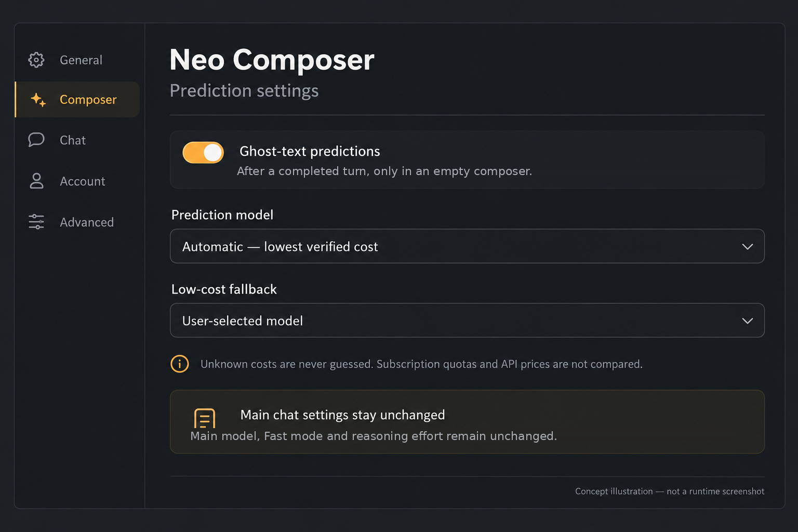
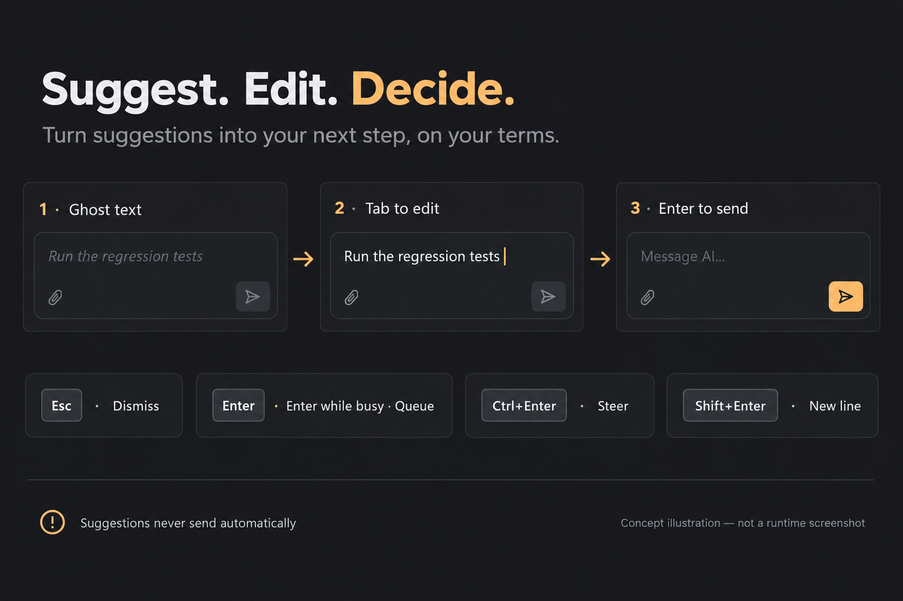
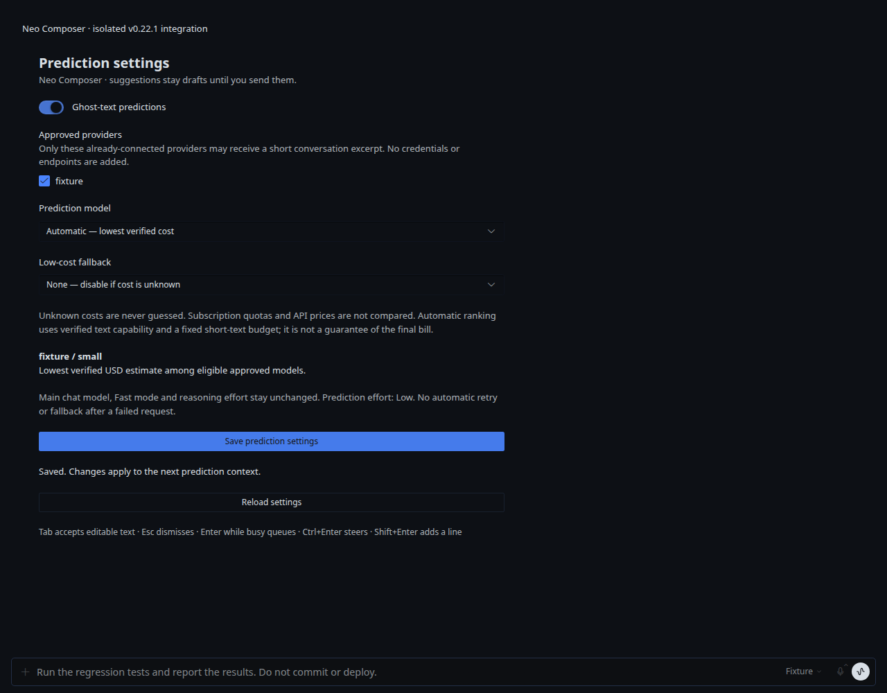

# Neo Composer

A standalone Hermes Desktop plugin for persistent, session-bound ghost-text suggestions and predictable busy-turn keys. The host retains native editing, focus and send ownership; model routing, settings and persistence live here.

**Compatibility:** version **0.4.3** targets Hermes **v0.22.2**, with the separate, explicitly installed **composer behavior v2** host seam. It is **not plug-and-play on an unmodified official Desktop build**. Unknown backend interfaces fail closed. An upstream seam proposal is separate from this plugin; no merge is implied.

## Interaction

- After a completed turn, an empty, focused composer may show a suggestion. This is not as-you-type autocomplete.
- **Tab** accepts it as an editable, undoable draft. It does not send.
- **Esc** persistently dismisses that candidate/context.
- **Enter** sends when idle and queues while busy.
- **Ctrl+Enter** while busy uses real `session.steer`, not redirect or cancel/restart. While a steer is available the composer shows an explicit key hint (localized; the queue control advertises Enter+Ctrl+Enter together).
- **Shift+Enter** inserts a newline.
- A cached empty prediction re-asks itself once after ten minutes on the next idle trigger; user decisions (Tab-accept, Esc) are never re-asked. Typing, attachments, IME and native completion UI retain priority. Refresh/reconnect does not intentionally repeat inference for the same persisted context.

## Prediction settings

Open **Settings ▸ Plugins → Neo Composer**. On hosts that predate the unified plugin settings surface, the plugin keeps its previous sidebar entry as a fallback so the settings stay reachable. Prediction is **off by default** and no provider is pre-approved. Enable only providers you already use, then choose automatic selection or an explicit model.

Automatic selection ranks eligible, account-bound text models by comparable verified API prices. It does not treat subscriptions as free or compare subscription quotas with API dollars. If comparable pricing is unavailable, it uses only your explicitly chosen low-cost fallback; otherwise prediction remains off with an explanation. An explicit model never silently falls back. Catalog metadata is read-only and must be fresh; refresh models in Hermes itself when necessary. Availability metadata is not an inference guarantee.

The plugin never changes the main chat's model, provider, Fast mode or reasoning effort. Predictions use an independent low-effort, bounded, text-only request, with no tools, auto-send, provider retry ladder or new credentials. A suggestion is not authorization to act.

### Deliberately unsupported sources

Unbound legacy API-key catalog aliases, root-borrowed account identities, ambiguous credential mixtures, macOS Anthropic Keychain identities and relocated Claude credential directories not represented in the host fingerprint are excluded or treated as unknown billing. Custom endpoints and changed host interfaces require separate validation. Do not loosen these checks merely to make a model appear.

## Install and upgrade

This repository is a unified agent-plugin package (`plugin.yaml`, Python backend and `desktop/plugin.js`). Install through Hermes' existing plugin flow, explicitly enable the backend and the Desktop half, and select prediction settings. On a split PC/backend installation, the Python package belongs on the backend host; the Desktop half belongs in that PC's resolved Desktop plugin directory. Never copy credentials between hosts.

**Install the host seam separately first.** `host/v0.22.2.patch` is source for developers, not a force installer. It must apply cleanly to exact release `d923a5eb487a17c0a68801bba9ef0f56c81040a8`, followed by the host's TypeScript checks, native composer tests and a real Windows renderer build. Check packaged executable, ASAR, main/preload and renderer provenance before replacing any installed renderer. The plugin itself never modifies core files.

Back up the previous package and renderer controls. Refuse unknown edits/version drift, preserve the existing Electron executable and main/preload, and retain a hash-bound rollback. The validated deployment uses per-machine private manifests; those contain local paths and are intentionally not published. Do not regenerate an install manifest against an unknown modified target. Disable the prediction setting before changing host versions. The current backend does not remount an already mounted Python API router: a controlled backend restart may be needed; reloading Desktop plugins alone does not prove backend activation.

Before any shared-runtime switch, notify other affected task owners and confirm safe pause checkpoints before controlled backend and client restarts. A queued notification alone is not pause confirmation. See [v0.22.2 validation](docs/compatibility-v0.22.2.md) for evidence and limits. The older host patch is retained only for historical releases, not for this package version.

## Develop and test

Use the pinned Hermes environment for Python imports; no standalone dependency resolver is shipped.

```sh
python run-tests.py
node --test plugin/controller.test.mjs
python build-plugin.py
```

`build-plugin.py` deterministically creates `dist/plugin.js`; copy the verified output to `desktop/plugin.js` when preparing a release. Its only runtime imports are the Hermes plugin SDK and the host's React.

Validated scope: backend unit/integration contracts, native Desktop composer tests, TypeScript, repository checks, Windows build, idempotent install/rollback and foreign-edit refusal. The Windows browser fixture uses real Composer, prompt actions, `session.steer` handler and safe-boundary delivery; inference and tool execution are deterministic substitutes. A separate real subscription-backed prediction on synthetic input succeeded without changing main configuration; cache reuse is verified by deterministic service/browser tests. Those facts do not prove a particular user's currently open window has reloaded.

## Related work

The interaction is substantially similar to [#137560](https://github.com/NousResearch/hermes-agent/pull/137560) and [#70970](https://github.com/NousResearch/hermes-agent/pull/70970). Those proposals implement suggestions in core (including deterministic extraction and, in #137560, optional prediction). This project instead keeps policy/persistence/model selection in an independent plugin and proposes only a native, versioned contribution seam. [#44081](https://github.com/NousResearch/hermes-agent/pull/44081) concerns a one-shot session-start CLI suggestion API. [#121383](https://github.com/NousResearch/hermes-agent/pull/121383) also overlaps the queue/steer keyboard experience, but implements a core busy-input-mode setting rather than this plugin contribution. No uniqueness claim is made for ghost text, Tab acceptance or queue/steer shortcuts.

## Illustrations and evidence

The two concepts below were generated through the existing ChatGPT image-generation integration; the settings explanatory copy was corrected manually. They are not runtime screenshots and the exact underlying image-model brand is not asserted.




This is a real rendering of the plugin settings in an isolated browser fixture with a deterministic provider catalog, **not the current Desktop window**:



MIT license. No private configuration, account fingerprints, credentials or machine deployment logs are included.
